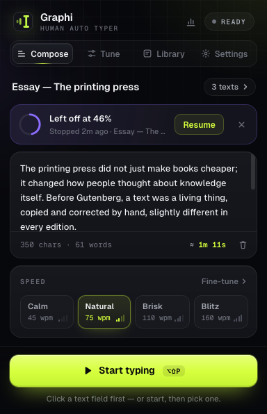
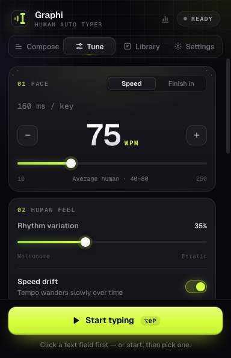

# Graphi — Human Auto Typer for Firefox

Graphi types your text into Google Docs, Google Slides and almost any web text field — one keystroke at a time, at a natural human rhythm, with optional realistic typos that it corrects as it goes.

It is a Firefox-native take on the *Write It — Auto Typer* Chrome extension, rebuilt from scratch as a Manifest V3 WebExtension with a dark, HUD-inspired interface.

  

---

## Install

**Try it now (temporary, removed when Firefox restarts)**

1. Open `about:debugging#/runtime/this-firefox`
2. Click **Load Temporary Add-on…** and pick `extension/manifest.json` (or `dist/graphi-1.2.0.xpi`)

**Keep it installed permanently**

Release Firefox only installs Mozilla-signed add-ons permanently. Either:

- **Sign it for free (recommended):** upload `dist/graphi-1.2.0.xpi` at <https://addons.mozilla.org/developers/addon/submit/distribution> and choose *On your own* (unlisted). Mozilla returns a signed `.xpi` within minutes. Drag that into Firefox to install it permanently.
- **Or use Firefox Developer Edition / Nightly / ESR:** set `xpinstall.signatures.required` to `false` in `about:config`, then install the `.xpi` from `about:addons` → ⚙ → *Install Add-on From File…*

Rebuild the package any time with `./build.sh`.

**Private windows.** Firefox runs extensions in private windows only if you allow it: open `about:addons` → **Graphi** → set **Run in Private Windows** to **Allow**. Graphi shows these steps in Settings until it is allowed. In private windows it leaves no report, statistics or page address behind, unless you turn on **Settings → Keep reports from private windows**.

## Use it

1. Click the Graphi button in the toolbar and paste your text in **Compose**.
2. Pick a speed preset, or fine-tune everything in **Tune**.
3. Click into the field (or Google Doc) where the text should go.
4. Press **Start typing**, or press **Alt+Shift+P** without opening the popup.

If no field has focus when you start, Graphi waits for you to click one. A floating panel on the page shows progress, speed and time left, with Pause/Resume and Stop.

| Shortcut | Action |
| --- | --- |
| **Alt+Shift+P** | Start · pause · resume |
| **Alt+Shift+X** | Stop |
| **Alt+Shift+K** | Open Graphi |
| **Esc** (in the page) | Stop |
| **Ctrl/⌘+Enter** (in the editor) | Start |

You can rebind shortcuts in **Settings** (click one and press the new keys) or in `about:addons` → ⚙ → *Manage Extension Shortcuts*.

## Features

- **Human rhythm.** Speed from 10 to 250 WPM, adjustable rhythm variation, slow tempo drift, breaths after punctuation and paragraphs, and occasional "thinking" pauses.
- **Realistic mistakes.** Neighbouring-key slips, double taps and swapped letters at a rate you choose. They're corrected instantly or "noticed" a few keys later, and the final text always matches yours exactly.
- **Full control.** Start, pause, resume and stop from the popup, the on-page panel or keyboard shortcuts. Clicking or typing in the page pauses Graphi so you can take over, and resuming puts the caret back where it was. Typing pauses while the tab is in the background and resumes when you return.
- **Recovery.** Graphi remembers where a session stopped, even across reloads and browser restarts, and offers **Resume** from that point.
- **Finish in…** Instead of a speed, set how long the typing should take (1 minute to 10 hours). Graphi solves for the speed and keeps steering during the session so it lands on time.
- **Session reports.** Every finished or stopped session gets a report: average and peak speed, typing time, keystrokes, corrections, a speed-over-time chart, a keystroke-rhythm histogram, a list of pauses and a full keystroke replay with a scrubber. Open it from the 📊 button in the popup, the on-page panel when typing ends, or automatically (Settings → *Open report when done*). Reports are clearly labelled as automated Graphi sessions, stay on your device (last 30 kept) and can be exported as JSON.
- **Scheduled breaks.** Take a 1–10 minute break every 15, 30, 45 or 60 minutes of typing. Breaks start between words, vary a little each time, show a countdown on the page and can be ended early.
- **Detailed reports.** Beyond the charts and replay, each report breaks the session down per paragraph and minute by minute (characters, speed, corrections, pauses) and lists the settings used. **Print / PDF** gives a plain, logo-free version of the report with the final text, which always states that it was typed automatically with Graphi.
- **Library.** Keep multiple texts, search them, duplicate them, and delete with undo.
- **Live tuning.** Speed changes apply instantly to a running session.
- **Clear status.** The toolbar badge shows progress, a paused or waiting state, completion and errors. Error messages tell you what to do next.
- **Private.** No servers, no analytics, no network requests. Everything stays in `storage.local` on your device.

## Where it works

| Target | How Graphi types | Verified |
| --- | --- | --- |
| `<input>`, `<textarea>` | `execCommand('insertText')`, which produces trusted input events and native undo, plus synthetic key events | ✅ e2e, incl. React 18 controlled fields, input masks, `maxlength` |
| contenteditable / rich editors | `execCommand` with full browser key semantics (keydown → keypress → default action → keyup) | ✅ live: ProseMirror, CodeMirror 6, Lexical, Slate, Quill, Draft.js, Monaco |
| Google Docs & Slides | Key/text events into Docs' hidden `docs-texteventtarget-iframe`; self-calibrating (see below) | ✅ against a Docs-architecture simulator on `docs.google.com` · ⚠️ please confirm on your account |
| Same-origin iframes | Followed automatically | ✅ |
| Cross-origin iframes (e.g. Word for the web) | Needs the optional **Embedded editors** permission in Settings | ✅ cross-origin fixture · ⚠️ Word not tested live |

## Firefox differences and limitations

- **No `chrome.debugger` in Firefox.** Chrome auto-typers can send OS-level keystrokes through the DevTools protocol, and Firefox has no equivalent. Graphi uses the closest reliable alternatives. Edits made through `execCommand` are genuine browser edits with *trusted* `input` events. Key events, however, are synthetic (`isTrusted: false`), so a site that ignores untrusted keydowns won't see them, though the text still arrives.
- **Google Docs.** Docs draws the page on a canvas and reads keystrokes from a hidden iframe. Which events Docs consumes has changed over the years, so Graphi calibrates on the first character. It tries `keypress`, then legacy `textInput` (supported since Firefox 126), then `execCommand`, and keeps whichever one moves Docs' own caret. The strategies are ordered so a later one can never double-type. If Docs ever ignores typing, pick a method manually under **Settings → Google Docs input**. In Docs, after you take over mid-session, put the cursor back where typing should continue before resuming, because Graphi can't move Docs' canvas caret.
- **Pages Firefox protects** (`about:` pages, addons.mozilla.org, the PDF viewer, Reader View) can't be typed into by any extension. Graphi explains this instead of failing silently.
- **Background tabs** are throttled by Firefox. That's why typing pauses while a tab is hidden, which you can turn off in Settings.
- **Code editors** such as Monaco auto-indent and auto-close brackets, just as they would for a human typist.

## Permissions

| Permission | Why |
| --- | --- |
| `activeTab` | Access to the current tab *only* when you click the toolbar button or use a Graphi shortcut |
| `scripting` | Inject the typing runtime into that tab on demand. Nothing runs on pages you don't start Graphi on |
| `storage` | Save your texts and settings locally |
| *optional* `<all_urls>` | Only if you turn on **Embedded editors**, to reach editors inside cross-origin frames |

## Project structure

```
extension/
  manifest.json            MV3, Firefox event-page background, commands, gecko id
  background/background.js on-demand injection, frame selection, commands, badge, recovery
  content/engine.js        pure typing engine: timing, typos, pauses (no DOM)
  content/adapters.js      editor adapters: fields, contenteditable, Google Docs
  content/hud.js           on-page control panel (closed shadow DOM)
  content/content.js       session state machine, takeover/Esc/hidden-tab guards
  shared/storage.js        settings, library, recovery, estimates
  shared/format.js         shortcut & time formatting
  popup/                   popup.html/css, store, components, views (compose, tune, library, settings, dock)
  report/                  session report page: charts, pauses, keystroke replay
  assets/                  Geist & Geist Mono (OFL), SVG icons
tests/                     Marionette e2e suites (Ruby stdlib only), fixtures, screenshots
build.sh                   packages dist/graphi-<version>.xpi
```

## Tests

All suites drive a real, headless Firefox through its Marionette protocol. They need only Ruby's standard library and an installed Firefox, and they use throwaway profiles, never yours.

```sh
tests/run_all.sh                 # everything
ruby tests/e2e.rb takeover       # one group of the main suite
ruby tests/screenshots.rb        # regenerate tests/screenshots/
```

| Suite | Covers |
| --- | --- |
| `engine_test.rb` | 3,000 random texts × settings × resume offsets: every plan reproduces the text exactly |
| `e2e.rb` | Shortcut and popup start, every field type, errors, arming, pause/resume/stop, resume from offset, takeover by click/key/Esc, typo correction, speed accuracy, live tuning, hidden tabs, HUD toggle, cross-origin frames |
| `docs_e2e.rb` | Google Docs/Slides adapter against a simulator served as `docs.google.com`, for each input strategy, with typos |
| `editors_e2e.rb` | Live ProseMirror, CodeMirror 6, Lexical, Slate, Quill, Draft.js and Monaco demo pages (run with `TYPOS=8` to stress corrections) |
| `report_e2e.rb` | Keystroke log, report page (tiles, charts, tooltips, replay and scrubbing), stopped-session reports, auto-open, delete/undo, and a 1-minute *finish in* pacing run |
| `private_e2e.rb` | The permission hint in Settings, typing in a real private window, and no reports or addresses kept from private sessions unless you opt in |
| `breaks_e2e.rb` | Scheduled breaks start between words, pause typing, resume, and are kept out of the report's typing time |
| `lifecycle_e2e.rb` | Real toolbar popup, editing through the UI, the shortcut recorder, persistence across a Firefox restart, extension reload |
| `xpi_test.rb` | The packaged `.xpi` installs cleanly and types with default settings |

## Credits

Fonts: [Geist and Geist Mono](https://vercel.com/font) (SIL Open Font License, included). Visual direction inspired by Phenomenon Studio's *Shaga Odyssey* web design.
