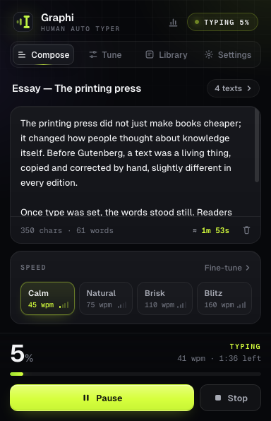

# Graphi

Graphi is a browser extension that types text for you, one key at a time, like a person would. Paste something in, click into a text box (or a Google Doc), hit start, and watch it go. It slows down after commas, pauses to "think" now and then, makes the odd typo and fixes it, and the end result always matches what you pasted.

It works in **Firefox** and in **Chrome** (plus other Chromium browsers like Edge and Brave).

  

## Getting it

Grab the latest files from the [Releases page](../../releases):

- `graphi-firefox-<version>.xpi` for Firefox
- `graphi-chrome-<version>.zip` for Chrome, Edge, Brave and friends

### Firefox

For a quick try, open `about:debugging#/runtime/this-firefox`, click **Load Temporary Add-on…** and pick the `.xpi`. Firefox forgets temporary add-ons when it restarts.

To keep it installed, Firefox wants the add-on signed by Mozilla. That's free: upload the `.xpi` at [addons.mozilla.org](https://addons.mozilla.org/developers/addon/submit/distribution), choose *On your own*, and you get a signed file back in a few minutes. (Developer Edition and Nightly can skip signing if you set `xpinstall.signatures.required` to `false`.)

### Chrome and other Chromium browsers

1. Unzip `graphi-chrome-<version>.zip` somewhere you'll keep it.
2. Go to `chrome://extensions` and switch on **Developer mode** (top right).
3. Click **Load unpacked** and pick the unzipped folder.

A Chrome Web Store listing is on the way.

## Using it

1. Click the Graphi icon in the toolbar and paste your text.
2. Pick a speed, or open **Tune** to change how it types.
3. Click where the text should go.
4. Press **Start typing**, or just press **Alt+Shift+P** without opening the popup.

If nothing is selected when you start, Graphi waits until you click a text box. A small panel in the corner of the page shows how far along it is, and lets you pause or stop.

| Keys | What it does |
| --- | --- |
| Alt+Shift+P | Start, pause or resume |
| Alt+Shift+X | Stop |
| Alt+Shift+K | Open Graphi |
| Esc (on the page) | Stop |

You can change the shortcuts in Graphi's settings on Firefox. Chrome keeps shortcuts on its own page (`chrome://extensions/shortcuts`), and Graphi will take you there.

## What it can do

- **Type at any speed** from 10 to 250 words per minute, with as much or as little variation as you like.
- **Finish on time.** Instead of picking a speed, tell it to finish in 20 minutes (or 3 hours) and it works out the pace.
- **Take breaks.** Every 15 to 60 minutes it can stop for a minute or a few, always between words.
- **Make mistakes, then fix them.** Wrong neighbouring keys, double taps, swapped letters. Some get caught right away, some a few letters later.
- **Get out of your way.** Click or type on the page and Graphi pauses so you can take over. Switch tabs and it waits for you.
- **Pick up where it left off**, even after a reload or a browser restart.
- **Keep a library** of texts you type often.
- **Show you a report** after every session: speed over time, rhythm, pauses, corrections, paragraph and minute breakdowns, and a replay of the whole thing. You can print it or save it as a PDF. Reports say plainly that the text was typed by Graphi.
- **Stay private.** No accounts, no servers, no tracking. Everything stays in your browser.

## Where it works

Plain text boxes, rich text editors (it's been tested against ProseMirror, CodeMirror, Lexical, Slate, Quill, Draft.js and Monaco in both browsers), Google Docs and Google Slides, and editors inside frames once you switch on **Embedded editors** in settings.

A couple of things to know:

- Browsers don't let any extension type on their own pages (`about:`, `chrome://`, the add-on and extension stores, the PDF viewer). Graphi will tell you when that's the problem.
- Google Docs draws text on a canvas and reads keys from a hidden frame. Graphi figures out on the first letter which kind of key event your Docs accepts. If Docs ever ignores it, there's a manual switch under **Settings → Google Docs input**. It's been tested against a Docs-style test page; I'd love to hear how it does on real documents.
- Private and incognito windows need your OK first, because browsers require it. Graphi's settings walk you through it. Nothing from a private session is saved unless you ask for that.

## Permissions

Graphi asks for as little as it can:

- **activeTab**: touch the current tab only when you click the icon or use a shortcut
- **scripting**: load the typing code into that tab, and only that tab
- **storage**: remember your texts and settings
- **all sites** (optional, off by default): only needed for editors inside embedded frames, like Word on the web

## Project layout

```
src/            everything both browsers share: popup, report page, typing engine, editor support
platforms/      the bits that differ per browser: manifests and Chrome's PNG icons
scripts/        build, icon and screenshot helpers
tests/          Firefox and Chrome end-to-end tests, unit tests, fixtures
docs/           screenshots, privacy policy, changelog, notes for developers
```

To build both packages:

```sh
scripts/build.sh
```

That puts unpacked builds in `dist/firefox` and `dist/chrome`, plus the `.xpi` and `.zip` next to them. There's nothing to install first, no npm or bundler. See [docs/development.md](docs/development.md) for running the tests.

## Credits

Uses the [Geist](https://vercel.com/font) fonts (SIL Open Font License). The look was inspired by Phenomenon Studio's *Shaga Odyssey* design.
